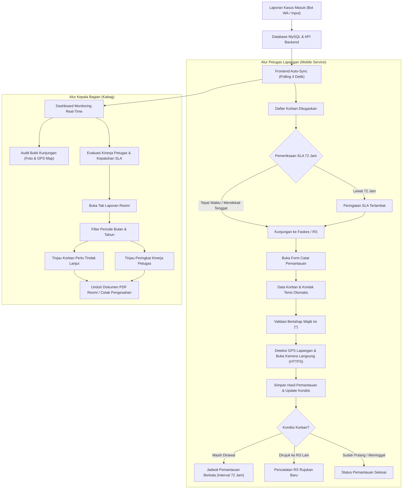

# Catatan Pembaruan Frontend & Alur Sistem (Frontend Update & System Workflow)
**Sistem Monitoring Kunjungan Korban & Kinerja Petugas Lapangan**  
**PT Jasa Raharja Kantor Wilayah Riau**

Dokumen ini merangkum seluruh pembaruan arsitektur antarmuka, dependensi plugin HTTPS lokal, aturan bisnis, perbaikan formulir pemantauan, dokumen laporan resmi, serta alur sistem (workflows) menyeluruh pada sisi frontend (`frontend/`).

---

## 1. Daftar Pustaka & Plugin Frontend

Berikut adalah dependensi dan pustaka pendukung utama yang digunakan dalam implementasi antarmuka dan pelaporan:

| Pustaka / Plugin | Kategori | Fungsi & Alasan Penggunaan |
| :--- | :--- | :--- |
| **`@vitejs/plugin-basic-ssl`** | Dev Tooling | Plugin sertifikat SSL/HTTPS otomatis untuk server Vite. **Sangat krusial untuk pengujian dari HP/perangkat mobile** via jaringan lokal (LAN/Wi-Fi), karena browser mobile (Chrome/Safari) secara ketat memblokir akses Web API Kamera (`getUserMedia`) dan GPS (`geolocation`) pada protokol non-HTTPS (`http://`). |
| **`jspdf`** | Dokumen & PDF | Engine pembuatan dokumen PDF secara programatik dari data JavaScript murni. |
| **`jspdf-autotable`** | Dokumen & PDF | Plugin pembuat tabel terstruktur, kop surat, header-footer dinamis, dan pemecahan halaman (page-break) dokumen dinas. |
| **`html2canvas`** | Dokumen & PDF | Generator kanvas DOM untuk kebutuhan ekspor grafis dan dokumentasi visual. |
| **`lucide-react`** | UI Ikonografi | Paket ikon SVG modern untuk antarmuka pengguna (FileText, Printer, Download, Users, Camera, MapPin, dll.). |
| **`date-fns`** & **`dateUtils.js`** | Utilitas Waktu | Parser tanggal robust (mendukung ISO, DD/MM/YYYY, timestamp) dan format standar Bahasa Indonesia (*contoh: 24 November 2026, 16.10 WIB*). |
| **`dompurify`** | Keamanan Data | Sanitasi teks dan keamanan rendering string dari input eksternal. |
| **`recharts`** | Visualisasi Metrik | Pustaka diagram interaktif untuk visualisasi grafik performa petugas dan tren kunjungan. |
| **`tailwindcss`** | Styling Responsif | Framework styling utilitas tinggi responsif desktop & mobile, termasuk konfigurasi cetak rapi (`@media print`). |

### Konfigurasi `@vitejs/plugin-basic-ssl` pada `vite.config.js`:
```javascript
import { defineConfig } from 'vite';
import react from '@vitejs/plugin-react';
import tailwindcss from '@tailwindcss/vite';
import basicSsl from '@vitejs/plugin-basic-ssl';

export default defineConfig({
  plugins: [
    react(),
    tailwindcss(),
    basicSsl() // Mengaktifkan HTTPS lokal otomatis untuk izin Kamera & GPS HP
  ],
  server: {
    host: true, // Membuka akses IP LAN agar bisa dibuka dari HP (https://192.168.x.x:5173)
    port: 5173
  }
});
```

---

## 2. Alur Sistem Aplikasi (System Workflows)

Aplikasi ini mengintegrasikan dua peran utama (**Petugas Lapangan** dan **Kepala Bagian**) dengan alur operasional berbasis SLA (Service Level Agreement) maksimal 3 hari (72 jam).



---

## 3. Rincian Alur Berdasarkan Peran Pengguna

### A. Alur Kerja Petugas Lapangan (Mobile Service Officer)
1. **Penerimaan & Notifikasi Kasus:**
   - Kasus laka baru yang diterima sistem otomatis terdistribusi ke petugas sesuai plotting rumah sakit.
   - Status korban awal: **Menunggu Kunjungan Awal** dengan batas waktu SLA maksimal 72 jam.
2. **Kunjungan Lapangan & Pembukaan Form:**
   - Petugas datang ke fasilitas kesehatan tempat korban dirawat.
   - Petugas membuka menu **Daftar Korban** / **Pemantauan Berkala** lalu menekan tombol **Catat Kunjungan**.
3. **Pengisian Formulir Pemantauan Bertahap (`FormPemantauanModal.jsx`):**
   - **Tahap 1 (Informasi Kunjungan):** Input tanggal dan jam kunjungan. Informasi RS dan identitas korban terkunci aman.
   - **Tahap 2 (Hasil Kunjungan):** 
     - Memilih kondisi faktual korban (*Masih Dirawat*, *Sudah Pulang*, *Rujukan*, *Meninggal Dunia*).
     - Mencentang checklist tindakan medis & koordinasi faskes.
     - Mengisi perkembangan luka atau estimasi biaya perawatan (opsional/fleksibel).
     - Mengisi data keluarga/pendamping (opsional; jika kunjungan sebelumnya sudah pernah diisi, otomatis terisi kembali).
   - **Tahap 3 (Dokumentasi & Validasi GPS):**
     - Petugas menekan **Deteksi GPS Perangkat** untuk mengunci koordinat latitude-longitude faktual.
     - Petugas menekan **Buka Kamera Langsung** untuk memotret kondisi lapangan (foto otomatis diberi watermark identitas, waktu, dan RS).
   - **Tahap 4 (Review & Simpan):** Petugas memeriksa rangkuman lalu menyimpan data.
4. **Kelanjutan Pemantauan:**
   - Jika korban masih dirawat, sistem otomatis menjadwalkan kunjungan lanjutan dengan interval maksimal 3 hari (72 jam) dari kunjungan terakhir.
   - Jika korban dinyatakan sembuh/pulang atau meninggal dunia, siklus pemantauan ditutup sebagai **Selesai**.

---

### B. Alur Kerja Kepala Bagian (Kabag)
1. **Pemantauan Dashboard & Kepatuhan SLA:**
   - Kabag meninjau rekapitulasi real-time jumlah korban aktif, kunjungan hari ini, status SLA (*Tepat Waktu*, *Mendekati Tenggat*, *Terlambat*), serta sebaran korban per rumah sakit.
2. **Audit & Verifikasi Lapangan:**
   - Melalui menu **Monitoring Kunjungan**, Kabag dapat membuka rincian audit kunjungan: memeriksa foto dokumentasi faktual lapangan, mencocokkan titik koordinat GPS pada Google Maps, memeriksa checklist tindakan petugas, serta catatan riwayat perkembangan korban.
3. **Evaluasi Kinerja Petugas (`KabagOfficerPerformance.jsx`):**
   - **Tab Ringkasan:** Peringkat ketepatan waktu kunjungan dan kepatuhan SLA seluruh petugas Mobile Service.
   - **Tab Detail Kinerja:** Profil detail per petugas, riwayat tugas, rasio ketepatan waktu, dan daftar korban yang ditangani.
   - **Tab Laporan:** Menampilkan lembar dokumen dinas resmi.
4. **Penerbitan Dokumen Laporan Resmi (`KabagReportPage.jsx`):**
   - Kabag memilih filter **Bulan** dan **Tahun**.
   - Sistem merekap data aktual:
     - 4 angka ringkasan eksekutif (*Total Korban*, *Total Kunjungan*, *Perlu Tindak Lanjut*, *Selesai*).
     - Tabel **Daftar Korban yang Perlu Ditindaklanjuti** (hanya korban yang terlambat kunjungan atau belum ditindaklanjuti sesuai SLA, tidak memasukkan korban selesai).
     - Tabel **Peringkat Kinerja Petugas** (diurutkan berdasarkan kepatuhan SLA aktual; jumlah korban murni sebagai informasi beban kerja).
     - Lembar pengesahan tanda tangan otomatis terisi nama dan NIP akun Kabag yang sedang login (tanpa nama dummy hardcode).
   - Kabag dapat mengunduh dokumen dalam format PDF atau mencetaknya langsung.

---

## 4. Mesin Perhitungan SLA & KPI (`slaService.js`)

Sistem menggunakan logika perhitungan waktu seragam untuk menjamin konsistensi evaluasi antara layar Petugas dan Kabag:

| Parameter SLA | Ketentuan Waktu | Status yang Dihasilkan |
| :--- | :--- | :--- |
| **Kunjungan Pertama** | Maksimal 72 Jam (3 Hari) dari `tanggalInformasiDiterima` | - **Tepat Waktu:** Selesai $\le$ 72 jam<br>- **Mendekati Tenggat:** Belum dikunjungi & sisa waktu $\le$ 24 jam<br>- **Terlambat:** Lewat 72 jam belum dikunjungi |
| **Pemantauan Lanjutan** | Maksimal 72 Jam (3 Hari) dari kunjungan terakhir | - **Tepat Waktu:** Kunjungan berikutnya $\le$ 72 jam<br>- **Terlambat:** Jarak kunjungan $>$ 72 jam |
| **Kasus Selesai** | Korban dinyatakan *Sudah Pulang*, *Meninggal Dunia*, atau *Selesai* | SLA pemantauan ditutup (**Selesai Dipantau**), tidak lagi masuk ke daftar tugas terlambat / perlu tindak lanjut |

---

## 5. Ringkasan Pembaruan Berkas Frontend

- `frontend/vite.config.js`: Penambahan plugin `basicSsl()` dan konfigurasi `server.host: true`.
- `frontend/package.json`: Penambahan pustaka `@vitejs/plugin-basic-ssl` pada `devDependencies`.
- `frontend/src/pages/kabag/KabagReportPage.jsx`: Komponen lembar dokumen laporan resmi Kabag dengan pengambilan data tanda tangan dinamis tanpa dummy.
- `frontend/src/pages/kabag/KabagOfficerPerformance.jsx`: Integrasi tab dokumen laporan pada Kinerja Petugas.
- `frontend/src/services/pdfReportService.js`: Generator PDF resmi `generateOfficialKabagReportPdf()`.
- `frontend/src/components/layout/Sidebar.jsx` & `MobileNav.jsx`: Pembersihan struktur navigasi agar tetap bersih dan standar.
- `frontend/src/components/petugas/FormPemantauanModal.jsx`: Validasi bertahap, tanda wajib `*`, dan auto-prefill riwayat sebelumnya.
- `frontend/src/components/petugas/CameraCapture.jsx` & `GpsCapture.jsx`: Pemaksaan kamera langsung dan deteksi GPS perangkat aktif.
- `frontend/src/pages/petugas/PetugasVictimDetail.jsx` & `VictimDetailDrawer.jsx`: Pembersihan informasi rujukan dan penambahan label nomor kontak.

---
*Catatan Keamanan & Arsitektur: Seluruh pembaruan di atas diterapkan murni pada sisi frontend (`frontend/`). Backend (`backend/`) dan Bot WhatsApp (`bot/`) tetap 100% aman dan tidak mengalami modifikasi apa pun.*
